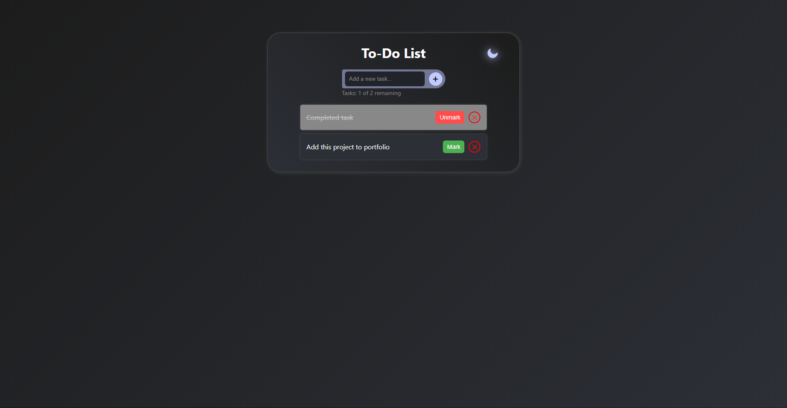

<h1 align="center">📝 To-Do List</h1>

  
  
  
   
  

Made on 🟢 November 19, 2026

---

## 🖼 Project Preview

  

🔗 Live Demo: https://danislw.github.io/To-Do-List/

*The application is hosted using GitHub Pages.*

---

## 🧠 Project Details

**To-Do List** is a clean, lightweight, and responsive task management web application designed to help users organize their daily activities efficiently[cite: 1, 2, 3].

The application focuses on a minimal UI design, smooth theme transitions, and a fast, distraction-free user experience[cite: 1, 3].
Everything was built from scratch using **vanilla HTML, CSS, and JavaScript**, with browser `localStorage` to keep tasks and theme preferences saved across sessions[cite: 1, 2, 3].

The goal of this project is to deliver a practical, intuitive productivity tool with both Dark and Light mode support[cite: 1, 2, 3].

---

## ✨ Features

- 🌓 Dark & Light theme toggle with persistent preference[cite: 1, 2]
- ➕ Quick task creation via button click or `Enter` key[cite: 1, 2]
- ✅ Mark / Unmark tasks as completed with strikethrough styling[cite: 2, 3]
- 🗑️ Instant task deletion[cite: 2]
- 📊 Live counter for remaining and total tasks[cite: 1, 2]
- 💾 Automatic saving using `localStorage`[cite: 2]
- 📱 Clean, responsive layout[cite: 1, 3]
- 🚀 Fast and lightweight[cite: 1, 2, 3]

---

## 🛠️ Technologies Used

This project was developed using:

- 🧱 **HTML5** - Application structure and inline SVG icons[cite: 1]
- 🎨 **CSS3** - Custom styling, gradients, Flexbox layout, and Dark/Light mode themes[cite: 3]
- ⚡ **JavaScript (ES6)** - Task management, DOM manipulation, and `localStorage` persistence[cite: 2]

👉 No external frameworks or libraries were used[cite: 1, 2, 3].

---

## 👨‍💻 Author

Created and maintained by
**Datcu Daniel-Alexandru**
